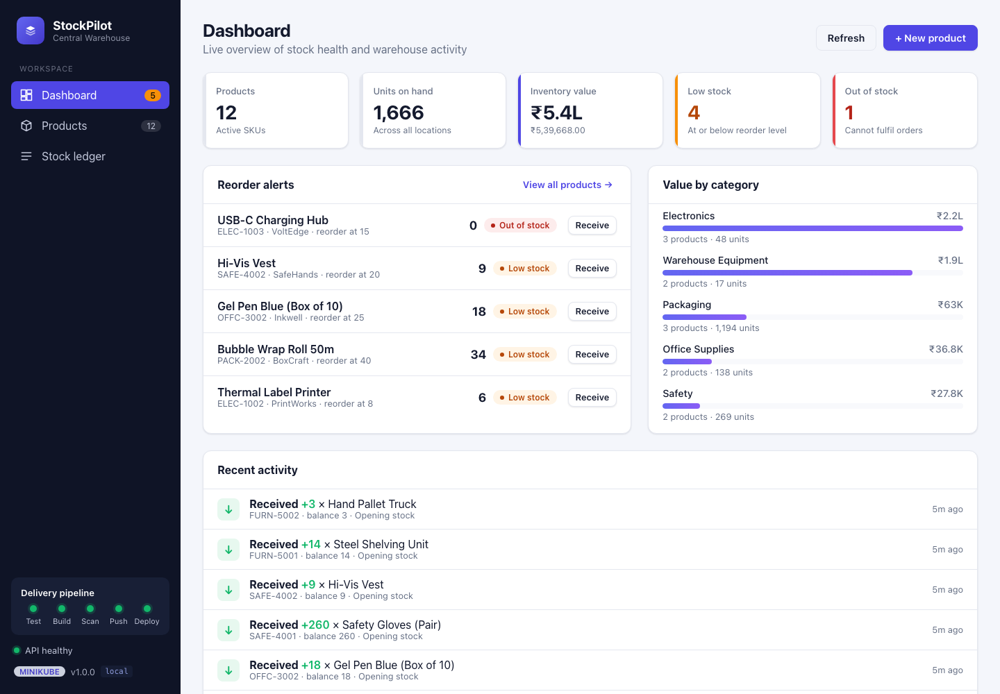
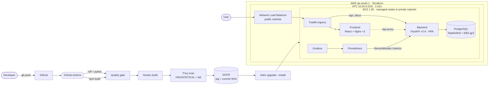
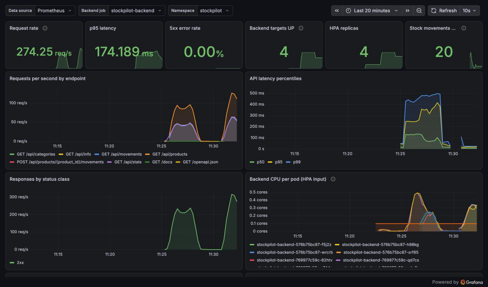

# StockPilot

[](https://github.com/Talin12/stockpilot/actions/workflows/ci-cd.yml)

**StockPilot is an inventory management app for a small warehouse.** It tracks products, stock levels and
reorder points. Every receipt, shipment and stock-count adjustment is written to an append-only ledger.
The dashboard shows what needs reordering, what the stock is worth, and where it sits.

This repository is my DevOps capstone. It takes the app from a laptop to a monitored Kubernetes cluster on
AWS: Git → tests → Docker → security scan → registry → Terraform → EKS → Helm → Ingress → autoscaling →
Prometheus/Grafana → troubleshooting.



---

## Contents

1. [Features](#features)
2. [Architecture](#architecture)
3. [Run it locally (Docker Compose)](#run-it-locally-docker-compose)
4. [REST API](#rest-api)
5. [Tests and code quality](#tests-and-code-quality)
6. [CI/CD pipeline](#cicd-pipeline)
7. [Security](#security)
8. [Infrastructure as Code (Terraform)](#infrastructure-as-code-terraform)
9. [Kubernetes and Helm](#kubernetes-and-helm)
10. [Monitoring](#monitoring)
11. [Troubleshooting lab](#troubleshooting-lab)
12. [Repository layout](#repository-layout)
13. [Rubric mapping](#rubric-mapping)

---

## Features

| Area | What it does |
|------|--------------|
| **Dashboard** | KPI cards (products, units on hand, inventory value in ₹, low stock, out of stock), reorder alerts with one-click *Receive*, value-by-category bars, recent activity feed |
| **Products** | Search by name/SKU/supplier, filter by category and stock status, a stock meter against the reorder level, create/edit/delete |
| **Stock movements** | *Receive* (PO in), *Ship* (order out), *Adjust* (cycle-count correction). Over-shipping is rejected with `409 Conflict` |
| **Stock ledger** | Append-only audit trail: every change records the delta and the resulting balance |
| **Ops-friendly** | `/health` (liveness), `/ready` (DB-aware readiness), `/metrics` (Prometheus), and a build badge in the UI showing the running commit SHA |
| **Responsive UI** | Collapsible sidebar; tables turn into cards on phones; loading skeletons, error banner with retry, toasts |

## Architecture



| Layer | Technology |
|-------|-----------|
| Frontend | React 19 + Vite 8, plain CSS (responsive), served by unprivileged Nginx |
| Backend | Python 3.13, FastAPI, SQLAlchemy 2, Pydantic 2, Alembic migrations |
| Database | PostgreSQL 17 |
| Tests | pytest (+ coverage gate), ruff lint/format |
| Containers | Multi-stage Dockerfiles, non-root users, Docker Compose |
| CI/CD | GitHub Actions (all actions pinned to commit SHAs), GHCR |
| Security | Trivy image scanning (fails on fixable HIGH/CRITICAL), restricted Pod Security Standard |
| IaC | Terraform: `terraform-aws-modules/vpc` v6 + `eks` v21, AWS provider v6 |
| Platform | Kubernetes (EKS 1.35 / minikube), Helm 4, Traefik ingress, HPA, metrics-server |
| Observability | kube-prometheus-stack: Prometheus Operator, Prometheus, Grafana, alert rules |

## Run it locally (Docker Compose)

Requirements: Docker Desktop.

```bash
docker compose up --build
```

| URL | What |
|-----|------|
| http://localhost:3000 | StockPilot UI (Nginx proxies `/api` to the backend) |
| http://localhost:8000/docs | Swagger / OpenAPI |
| http://localhost:8000/health · `/ready` · `/metrics` | Probes and Prometheus metrics |

On start the backend waits for PostgreSQL, runs `alembic upgrade head`, and seeds 12 demo products.
`docker compose down -v` stops everything and wipes the database volume.
`BASE_URL=http://localhost:3000 ./scripts/smoke-test.sh` runs a full create → update → ship → delete check.

<details>
<summary>Run the backend without Docker</summary>

```bash
cd backend
python3 -m venv .venv && source .venv/bin/activate
pip install -r requirements-dev.txt
cp .env.example .env                      # points at a local PostgreSQL
alembic upgrade head
uvicorn app.main:app --reload --port 8000
# frontend, in another terminal:  cd frontend && npm ci && npm run dev  ->  http://localhost:5173
```
</details>

## REST API

| Method | Path | Purpose |
|--------|------|---------|
| GET | `/health` | Liveness: process is up (never touches the DB) |
| GET | `/ready` | Readiness: `SELECT 1` against PostgreSQL, `503` if unreachable |
| GET | `/metrics` | Prometheus metrics (HTTP + business counters) |
| GET | `/api/info` | Service name, version, environment, **git SHA of the running build** |
| GET | `/api/products` | List; filters `search`, `category`, `stock_status=IN_STOCK\|LOW_STOCK\|OUT_OF_STOCK` |
| GET | `/api/products/{id}` | One product |
| POST | `/api/products` | Create (opening quantity is recorded as the first ledger entry); `409` on duplicate SKU |
| PUT | `/api/products/{id}` | Partial update of details (quantity is only changed through movements) |
| DELETE | `/api/products/{id}` | Delete product and its history |
| GET | `/api/products/{id}/movements` | Ledger for one product |
| POST | `/api/products/{id}/movements` | `RECEIVED` / `SHIPPED` / `ADJUSTED`; `409` if it would go negative |
| GET | `/api/movements?limit=` | Recent activity across all products |
| GET | `/api/stats` | Totals, inventory value, low/out-of-stock counts, per-category breakdown |
| GET | `/api/categories` | Distinct categories |

The schema is managed by Alembic (`backend/alembic/versions/`): `0001` creates `products` and `0002`
creates `stock_movements`. Containers run migrations under a PostgreSQL advisory lock, so several
replicas starting at once take turns instead of racing.

## Tests and code quality

```bash
cd backend && pip install -r requirements-dev.txt
ruff check . && ruff format --check .
pytest -v --cov
```

* **38 tests** across 5 files cover every endpoint, plus validation errors, 404/409 paths, stock-status
  transitions, the readiness 503 path, and seeding idempotency.
* Tests never touch PostgreSQL: `tests/conftest.py` gives each test a fresh in-memory SQLite database
  through FastAPI dependency overrides.
* `test_migrations.py` runs `alembic upgrade head` → `downgrade base`. It also fails if a model changes
  without a matching migration (schema drift check).
* CI enforces ≥ 85% coverage (currently ~96%).

## CI/CD pipeline

[`.github/workflows/ci-cd.yml`](.github/workflows/ci-cd.yml) runs on every push and pull request to `main`:

```text
backend-tests ──┐   ruff + pytest (coverage gate)        ┐
frontend-build ─┼─> build-scan-push [backend, frontend]  ├─> deploy (EKS, Helm)
infra-lint ─────┘   terraform validate + helm lint        ┘   docker build → Trivy → push ghcr.io/…:<sha>
```

* **Tests gate everything.** If pytest fails, no image is built or pushed.
* **Images are tagged with the full commit SHA** (`ghcr.io/talin12/stockpilot-backend:<sha>`), never
  `latest`. The Helm chart refuses to render without an explicit tag, and the UI shows the SHA it runs.
* **Push and deploy only happen on `main`.** Pull requests run the same build and scan, but publish nothing.
* **Deploy** runs `helm upgrade --install --rollback-on-failure --wait`, so a broken release rolls back
  by itself. It authenticates to AWS with **GitHub OIDC**: no AWS keys are stored in GitHub
  (see [docs/RUNBOOK.md](docs/RUNBOOK.md#7-enable-continuous-deployment)).
* **Every action is pinned to a full commit SHA.** In March 2026 the `trivy-action` tags were repointed
  at credential-stealing code (CVE-2026-33634), which is exactly the attack pinning prevents.

## Security

* **Trivy** scans both images for OS and library CVEs and fails the build on fixable HIGH/CRITICAL
  findings. See [docs/SECURITY.md](docs/SECURITY.md) for what it found and how it was fixed: 4 HIGH CVEs
  in pip's vendored libraries, resolved by removing pip from the runtime image.
* **Non-root everywhere:** the backend runs as uid 10001, the frontend as uid 101 (`nginx-unprivileged`)
  and PostgreSQL as uid 70. The `stockpilot` namespace enforces the Kubernetes **restricted** Pod
  Security Standard: no root, no privilege escalation, all capabilities dropped, seccomp `RuntimeDefault`.
* **No secrets in Git:** the DB password is generated by Helm on first install and kept across upgrades.
  AWS access uses short-lived credentials (`aws login` locally, OIDC in CI).
* **Nginx hardening:** `X-Frame-Options`, `X-Content-Type-Options` and `Referrer-Policy` headers, and no
  version disclosure.

## Infrastructure as Code (Terraform)

[`terraform/`](terraform) provisions in `ap-south-1`:

* **VPC** `10.20.0.0/16` across 2 AZs: **2 public subnets** (load balancer, NAT) and 2 private subnets
  (worker nodes), with a single NAT gateway to keep costs down.
* **EKS 1.35** (in standard support, avoiding the 6× extended-support price) with a managed node group
  (2 × m7i-flex.large, AL2023), which works on AWS Free-plan accounts as well as paid ones.
* Add-ons: VPC CNI, CoreDNS, kube-proxy, **EBS CSI driver** (IAM via EKS Pod Identity, no node-wide
  permissions), **metrics-server** for the HPA, and Pod Identity Agent.
* An IAM OIDC provider and deploy role for GitHub Actions ([`github-oidc.tf`](terraform/github-oidc.tf)).

```bash
cd terraform
cp terraform.tfvars.example terraform.tfvars
terraform init && terraform plan && terraform apply     # ~15 min
terraform destroy                                        # always, when done
```

Step-by-step (with expected outputs and costs): [docs/RUNBOOK.md](docs/RUNBOOK.md).

## Kubernetes and Helm

[`helm/stockpilot`](helm/stockpilot) packages the whole app:

| Resource | Details |
|----------|---------|
| Deployments | backend (2–6 replicas, HPA), frontend (2 replicas); rolling updates with `maxUnavailable: 0` |
| Probes | backend: startup + readiness (`/ready`) + liveness (`/health`); frontend: `/healthz` |
| Services | `ClusterIP` for backend, frontend, postgres |
| StatefulSet | PostgreSQL 17 with a PVC (gp3 EBS on AWS) |
| Ingress | `/api`, `/docs`, `/openapi.json` → backend; `/` → frontend (class `traefik`) |
| HPA | CPU target 60%, fast scale-up, 60s scale-down stabilisation |
| PDBs | keep ≥ 1 backend and frontend Pod during node drains |
| Monitoring | ServiceMonitor, PrometheusRule (backend down, 5xx rate, p95 latency), Grafana dashboard ConfigMap |
| `helm test` | in-cluster smoke test of `/ready`, `/api/stats` and the frontend |

The ingress controller is **Traefik**. The community `ingress-nginx` controller the course originally used
was retired by Kubernetes SIG Network in March 2026 and no longer receives security fixes.
Traefik implements the same standard `Ingress` API.

**Local cluster (minikube), one command:**

```bash
./scripts/minikube-up.sh               # minikube + metrics-server + Prometheus/Grafana + Traefik + app
minikube tunnel -p stockpilot          # separate terminal
echo "127.0.0.1 stockpilot.local" | sudo tee -a /etc/hosts
open http://stockpilot.local
```

**EKS:** `./scripts/eks-bootstrap.sh <commit-sha>` after `terraform apply`. See [docs/RUNBOOK.md](docs/RUNBOOK.md).

## Monitoring

* The backend exposes `/metrics`: request count, latency histogram and in-flight requests per endpoint
  (`prometheus-fastapi-instrumentator`), plus business counters `stockpilot_stock_movements_total`,
  `stockpilot_units_moved_total`, `stockpilot_products_created_total` and
  `stockpilot_rejected_shipments_total`.
* [`monitoring/kube-prometheus-stack-values.yaml`](monitoring/kube-prometheus-stack-values.yaml) installs
  Prometheus and Grafana, configured to discover ServiceMonitors, rules and dashboards from every namespace.
* The **StockPilot / Overview** Grafana dashboard ships with the Helm chart. It shows request rate, p95
  latency, 5xx rate, targets up, HPA replicas (current/desired/max), CPU per backend pod against its
  request, responses by status, and stock movements per minute.
* `./scripts/load-test.sh` generates traffic to make the dashboard move and the HPA scale.



## Troubleshooting lab

[`troubleshooting/`](troubleshooting) has four broken-on-purpose scenarios, each with symptoms,
diagnosis commands, root cause and fix: **ImagePullBackOff**, **Service with no endpoints** (selector and
port mismatch), **CrashLoopBackOff** (bad `DATABASE_URL`) and **Pending** (unschedulable resource requests).

## Repository layout

```text
.
├── backend/                 FastAPI app, Alembic migrations, pytest suite, Dockerfile
│   ├── app/                 main.py, routers/, models.py, schemas.py, services.py, metrics.py, seed.py
│   ├── alembic/versions/    0001_create_products, 0002_create_stock_movements
│   └── tests/               conftest.py + 5 test modules (38 tests)
├── frontend/                React + Vite SPA, Nginx config template, multi-stage Dockerfile
├── docker-compose.yml       postgres + backend + frontend with health-gated startup
├── .github/workflows/       ci-cd.yml
├── terraform/               VPC, EKS, add-ons, GitHub OIDC role, tfvars example
├── k8s/                     namespace (restricted PSS), gp3 StorageClass, Traefik values
├── helm/stockpilot/         chart: values, values-dev (minikube), values-prod (EKS), templates, dashboard
├── monitoring/              kube-prometheus-stack values
├── troubleshooting/         4 broken manifests + guide
├── scripts/                 minikube-up, eks-bootstrap, install-addons, load-test, smoke-test
└── docs/                    RUNBOOK (EKS + demo script), SECURITY (Trivy), SUBMISSION checklist, screenshots
```

## Rubric mapping

See [docs/SUBMISSION.md](docs/SUBMISSION.md) for every grading criterion, the file or screenshot that
satisfies it, and how to show it live. All 33 evidence screenshots (app, tests, Docker, pipeline, Trivy,
Terraform plan/destroy, AWS Console, kubectl/Helm on EKS, HPA, Prometheus, Grafana) are in
[docs/SCREENSHOTS.md](docs/SCREENSHOTS.md).
